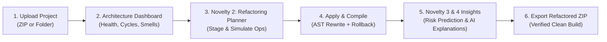

# AI-Powered Dependency & Architecture Refactoring Analyzer
## Complete User Manual & System Guide

---

## 1. System Overview & The Right User Flow

The **AI-Powered Dependency & Architecture Refactoring Analyzer** allows software engineers and architects to assess codebase quality, detect architectural smells and dependency cycles, simulate multi-step refactoring operations safely without touching disk files, and apply verified code transformations with automatic compiler rollback.



---

## 2. Step-by-Step User Workflow

### Step 1: Project Upload (`/projects/upload`)
* **What to input:**
  * Click **Browse / Choose File** and select a `.zip` archive of any Java project (Maven or Gradle layout), or provide a project folder path.
  * *(Optional)* Provide a custom project display name.
* **What happens:**
  * The system unzips the project in a sandboxed directory.
  * The Java Compiler Tree API (`javax.tools`) parses all `.java` files into an AST model.
  * A component dependency graph is constructed with zero third-party build dependencies.

---

### Step 2: Main Architecture Dashboard (`/dashboard`)
* **Key Metrics Displayed:**
  * **Architecture Health Score (0–100):** Comprehensive score based on Martin's metric formulas (Instability, Abstractness, Normalized Distance from Main Sequence $D$).
  * **Dependency Pressure (0–100):** Measures coupling density and afferent/efferent connection stress.
  * **Circular Dependencies Count:** Number of closed dependency loops discovered via Tarjan's Strongly Connected Components algorithm.
  * **Architectural Smells:** God Components, Feature Envy, Cyclical Dependencies, and Spaghetti Coupling.
* **Interactive Dependency Graph:**
  * Zoom, pan, and click on nodes (classes/packages) to see afferent (incoming) and efferent (outgoing) references.
  * Filter graph components by package name.

---

### Step 3: Simulation-Guided Refactoring Planner (`/planner` — Novelty 2)
*(This is the screen shown in your screenshot!)*

This screen allows you to design and test refactoring plans in a sandbox before changing any code.

```
+--------------------------------------+------------------------------------+
|   Candidate Operations Browser       |      Active Refactoring Plan       |
|                                      |                                    |
|  [Break Cycle: Order <-> Payment]    |  1. Break Cycle: Order <-> Payment |
|  [+ Add]                             |     [Up] [Down] [Remove]           |
|                                      |                                    |
|  [Extract Interface: IUserService]   |  2. Extract Interface: IUserService|
|  [+ Add]                             |     [Up] [Down] [Remove]           |
+--------------------------------------+------------------------------------+
                      [ ⚡ Simulate Combined Plan ]
```

1. **Candidate Operations Browser (Left Column):**
   * Displays high-value refactoring opportunities discovered automatically from cycles and heavy coupling (e.g. *Break Cycle*, *Extract Interface*, *Invert Dependency*).
   * **Input:** Click the blue **`+ Add`** button on one or more operations you want to execute.
2. **Active Refactoring Plan (Right Column):**
   * Shows your staged operations.
   * **Input:** You can re-order operations with arrows, remove an operation, or click **`Clear All`**.
3. **Simulate Combined Plan (Top Button):**
   * **Input:** Click the purple **`⚡ Simulate Combined Plan`** button.
   * **What happens:** The engine creates an in-memory graph snapshot and runs all selected operations together.
   * It checks for **Structural Conflicts** (e.g., Operation 2 modifying a component deleted or moved by Operation 1).
   * Displays the **Delta Preview**: Expected improvement in Architecture Health (e.g. $79.9 \rightarrow 88.5$) and elimination of cycles ($1 \rightarrow 0$).
4. **Approve & Apply Plan:**
   * Once simulated with **0 conflicts**, click **`Approve & Apply Plan`**.
   * The AST engine writes actual Java source changes to disk, adds Dependency Injection constructors, and compiles with `javac`. If any compilation error occurs, it rolls back automatically.

---

### Step 4: AI Architecture Risk Prediction (`/risk` — Novelty 3)
* **What it does:**
  * Uses machine learning over static dependency metrics combined with Git commit history (churn, co-change graph, temporal leakage prevention).
* **What to look for:**
  * **High-Risk Components:** Classes with high co-change coupling and structural instability.
  * **Risk Probability Score (0.0 to 1.0):** Likelihood of introducing architectural defects in upcoming commits.
  * **Preventative Recommendations:** Which classes should be split or modularized.

---

### Step 5: Verified Architecture Explanations (`/explanation` — Novelty 4)
* **What it does:**
  * AI architect powered by Google Gemini with **Automated Claim Verification**.
* **What to input:**
  * Type questions like:
    * *"Why does OrderService have high dependency pressure?"*
    * *"How should I break the cycle between PaymentService and OrderService?"*
* **How Claim Verification protects you:**
  * Every metric statement the LLM generates is parsed by the claim-verifier and validated against the actual AST graph.
  * Verified facts are flagged with **`[VERIFIED]`** (green badge).
  * Inaccurate statements or hallucinations are flagged as **`[REFUTED]`** or corrected.
  * **Offline Fallback:** If no Gemini API key or internet access is configured, an offline rule-based architect answers deterministically.

---

### Step 6: Export & Verify Refactored ZIP (`/projects/download/zip`)
* **What to input:**
  * Click **`Download Refactored ZIP`** in the top navigation bar.
* **What you get:**
  * A clean ZIP containing the modified source code, new decoupled interfaces, and updated caller classes.
  * Compiles out-of-the-box with `mvn clean compile` or `gradle build`.

---

## 3. Top Navigation Bar Quick Reference

| Navigation Link | Purpose |
| :--- | :--- |
| **New Analysis** | Upload a new Java project ZIP or choose another repository. |
| **🔮 Simulator** | Individual cycle-breaking simulation (Novelty 1). |
| **✨ Planner** | Multi-operation refactoring plan builder & conflict detector (Novelty 2). |
| **⚠️ Risk (Novelty 3)** | Machine Learning risk prediction based on code churn and static graph. |
| **🛡️ Verified Explanations (Novelty 4)** | Chat with AI architect with automatic hallucination checks. |
| **Download Refactored ZIP** | Export the updated, compiled, and tested project archive. |
| **Download Report** | Export an architectural assessment report (PDF / JSON). |
| **History** | Audit trail of previous analysis runs and applied refactorings. |
