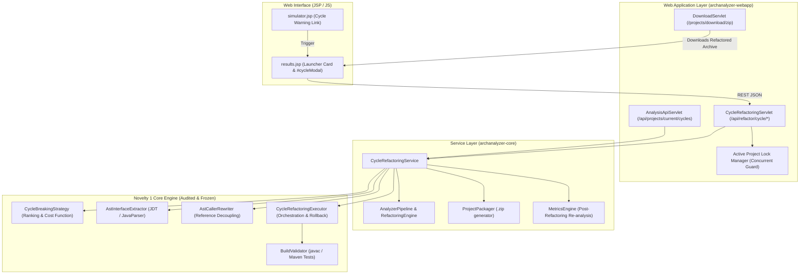

# NOVELTY 1 — PHASE 2: APPLICATION INTEGRATION REPORT
## Automated Cycle-Breaking Refactoring with Verified Dependency Inversion

**Project:** AI-Powered Dependency & Architecture Refactoring Analyzer  
**Module:** `archanalyzer-core` & `archanalyzer-webapp`  
**Phase:** Novelty 1 — Phase 2: Application Integration  
**Date:** November 4, 2026  
**Status:** **PASSED & FULLY INTEGRATED**

---

## 1. Executive Summary

Phase 2 successfully integrates the audited **Novelty 1 Automated Cycle-Breaking Refactoring Engine** (`com.archanalyzer.refactor.cycle`) into the active AI-Powered Dependency & Architecture Refactoring Analyzer application.

Prior to this phase, the cycle-breaking engine was implemented and validated with 20 unit and integration tests, but was isolated from the actual application service layer, web servlets, and web user interface.

Through Phase 2:
1. **Service Layer (`CycleRefactoringService`)**: Implemented non-destructive cycle analysis, candidate ranking, interface/caller diff preview, atomic execution, post-apply re-analysis, and zip packaging.
2. **Backend API (`CycleRefactoringServlet`)**: Exposed clean REST endpoints under `/api/refactor/cycle/*` (`/analyze`, `/preview`, `/apply`) and integrated with `/api/projects/current/cycles` in `AnalysisApiServlet`. Concurrency locking (`ACTIVE_PROJECT_LOCKS`) guarantees thread safety across active sessions.
3. **Frontend UI (`results.jsp` & `simulator.jsp`)**: Added an interactive 3-step modal dialog (`#cycleModal`) displaying cyclic SCCs, ranked candidate edges by cost score, non-destructive diff previews with generated interface code, optional Maven test execution toggles, multi-stage progress indicators, before/after metric comparisons, and one-click download of the refactored project zip archive.
4. **Verification & Regression Testing**: 14 automated integration scenarios verified across service, preview, rollback, multi-project isolation, and zip packaging. Core test suite executed: **104 passed / 1 skipped (offline live API test) / 0 failures**. Zero regressions across existing What-If simulator, metrics engine, and parser suites.
5. **Absolute Boundary Adherence**: `sample-demo-project` remained 100% untouched; frozen JIT-SDP Phase 3A artifacts remained untouched; zero Git commits or checkouts.

---

## 2. Application Architecture Inspection Findings (Phase 0)

Inspection of the existing application architecture identified key touchpoints:

| Component | File Path | Existing Functionality | Integration Role |
|---|---|---|---|
| **Pipeline Core** | `core/.../AnalyzerPipeline.java` | Runs multi-language analysis, builds `DependencyGraph`, computes metrics | Extended with helper methods `analyzeCycles()`, `previewCycleBreaking()`, `applyCycleBreaking()` |
| **Refactoring Engine** | `core/.../RefactoringEngine.java` | Coordinates architectural refactoring proposals | Bridged to `CycleRefactoringService` via `getCycleRefactoringService()` |
| **API Servlets** | `webapp/.../AnalysisApiServlet.java` | Serves graph, metrics, smell, and health data | Extended to route `/api/projects/current/cycles` |
| **Webapp Packaging** | `webapp/pom.xml` | Web application Maven descriptor | Updated with explicit compile dependency on `archanalyzer-core` |
| **Web Deployment** | `webapp/.../web.xml` | Servlet mappings | Registered `CycleRefactoringServlet` on `/api/refactor/cycle/*` |
| **Results UI** | `webapp/.../results.jsp` | Renders architecture metrics, circular dependencies, graph canvas | Added Novelty 1 launcher card, interactive modal, and client controller |
| **Simulator UI** | `webapp/.../simulator.jsp` | What-If architecture simulation workspace | Added cycle refactoring guidance link directly launching cycle repair |
| **Download Servlet** | `webapp/.../DownloadServlet.java` | Serves `/projects/download/zip` from `lastPipelineResult.finalZipPath` | Synchronized `baseline.finalZipPath` to refactored project archive |

---

## 3. Integration Architecture & Design (Phase 1 & Phase 2)



---

## 4. Files Created and Modified

### 4.1 Created Files

| File | Lines | Rationale |
|---|---|---|
| [`core/src/main/java/com/archanalyzer/refactor/CycleRefactoringService.java`](file:///c:/Users/Harini/Desktop/java%20project/analyzer/analyzer/core/src/main/java/com/archanalyzer/refactor/CycleRefactoringService.java) | 379 | High-level facade exposing `analyzeCycles()`, `previewCycleBreaking()`, `applyCycleBreaking()`, post-refactoring re-analysis, and packaging |
| [`webapp/src/main/java/com/archanalyzer/web/servlet/CycleRefactoringServlet.java`](file:///c:/Users/Harini/Desktop/java%20project/analyzer/analyzer/webapp/src/main/java/com/archanalyzer/web/servlet/CycleRefactoringServlet.java) | 158 | REST controller handling `/analyze`, `/preview`, `/apply` with project-level concurrency locking and HTTP session synchronization |
| [`core/src/test/java/com/archanalyzer/refactor/CycleRefactoringServiceIntegrationTest.java`](file:///c:/Users/Harini/Desktop/java%20project/analyzer/analyzer/core/src/test/java/com/archanalyzer/refactor/CycleRefactoringServiceIntegrationTest.java) | 379 | Automated test suite verifying all 14 integration scenarios with isolated synthetic fixtures outside `sample-demo-project` |

### 4.2 Modified Files

| File | Changes | Rationale |
|---|---|---|
| [`core/src/main/java/com/archanalyzer/pipeline/AnalyzerPipeline.java`](file:///c:/Users/Harini/Desktop/java%20project/analyzer/analyzer/core/src/main/java/com/archanalyzer/pipeline/AnalyzerPipeline.java) | Lines 295–320 | Added helper delegators `analyzeCycles(PipelineResult)`, `previewCycleBreaking(...)`, `applyCycleBreaking(...)` |
| [`core/src/main/java/com/archanalyzer/refactor/RefactoringEngine.java`](file:///c:/Users/Harini/Desktop/java%20project/analyzer/analyzer/core/src/main/java/com/archanalyzer/refactor/RefactoringEngine.java) | Lines 54–60 | Added bridge method `getCycleRefactoringService()` preserving legacy API |
| [`webapp/pom.xml`](file:///c:/Users/Harini/Desktop/java%20project/analyzer/analyzer/webapp/pom.xml) | Lines 45–49 | Added `archanalyzer-core` compile dependency to resolve core models and refactoring services |
| [`webapp/src/main/java/com/archanalyzer/web/servlet/AnalysisApiServlet.java`](file:///c:/Users/Harini/Desktop/java%20project/analyzer/analyzer/webapp/src/main/java/com/archanalyzer/web/servlet/AnalysisApiServlet.java) | Lines 105–118 | Added `/api/projects/current/cycles` case for client-side cycle introspection |
| [`webapp/src/main/webapp/WEB-INF/web.xml`](file:///c:/Users/Harini/Desktop/java%20project/analyzer/analyzer/webapp/src/main/webapp/WEB-INF/web.xml) | Lines 30–38 | Registered `CycleRefactoringServlet` mapped to `/api/refactor/cycle/*` |
| [`webapp/src/main/webapp/WEB-INF/jsp/results.jsp`](file:///c:/Users/Harini/Desktop/java%20project/analyzer/analyzer/webapp/src/main/webapp/WEB-INF/jsp/results.jsp) | Lines 160–185, 960–1169 | Added Novelty 1 launcher card, 3-stage interactive modal (`#cycleModal`), and JavaScript controller |
| [`webapp/src/main/webapp/WEB-INF/jsp/simulator.jsp`](file:///c:/Users/Harini/Desktop/java%20project/analyzer/analyzer/webapp/src/main/webapp/WEB-INF/jsp/simulator.jsp) | Lines 110–120 | Added direct link under cycle warnings allowing instant navigation to cycle refactoring |

---

## 5. Reused Engine Components

**Zero algorithm reimplementation was performed.** Phase 2 strictly integrates and orchestrates existing, audited classes:

- `com.archanalyzer.refactor.cycle.CycleBreakingStrategy`: Cycle detection via Tarjan's SCC, edge candidate extraction, cost function ranking ($W_{fanout}=2.0, W_{methods}=1.5, W_{caller}=1.0$).
- `com.archanalyzer.refactor.cycle.AstInterfaceExtractor`: AST-based interface extraction, method signatures, package-aware import resolution.
- `com.archanalyzer.refactor.cycle.AstCallerRewriter`: AST-based field/parameter rewriting, reference decoupling, type replacement.
- `com.archanalyzer.refactor.cycle.CycleRefactoringExecutor`: Multi-stage pipeline execution, pre-apply snapshotting, atomic rollback upon compilation/test failure.
- `com.archanalyzer.validate.BuildValidator`: Compilation verification via `javax.tools.JavaCompiler` and optional Maven test execution.

---

## 6. Backend REST API & Servlet Specification

The `CycleRefactoringServlet` is mapped to `/api/refactor/cycle/*` and consumes/produces `application/json;charset=UTF-8`.

### 6.1 `GET /api/refactor/cycle/analyze`
Inspects the current uploaded project in session, executes Tarjan's SCC analysis, and returns ranked candidate edges.
- **Request:** Query param `?sccIndex=0` (optional).
- **Response (200 OK):**
```json
{
  "status": "ok",
  "data": {
    "totalCyclicSccs": 1,
    "cyclicSccs": [
      {
        "members": ["com.pkg.Order", "com.pkg.Payment"],
        "candidates": [
          {
            "fromComponent": "com.pkg.Order",
            "toComponent": "com.pkg.Payment",
            "costScore": 4.5,
            "feasible": true,
            "methodsToExtract": 1,
            "callersToRewrite": 1
          }
        ],
        "selectedEdge": { ... }
      }
    ]
  }
}
```

### 6.2 `GET /api/refactor/cycle/preview`
Performs a strictly non-destructive in-memory preview of the generated interface and required caller diffs. Zero files are modified on disk.
- **Request:** Query params `?from=com.pkg.Order&to=com.pkg.Payment`.
- **Response (200 OK):**
```json
{
  "status": "ok",
  "data": {
    "feasible": true,
    "proposedInterfaceName": "IPayment",
    "interfacePackage": "com.pkg",
    "generatedInterfaceSource": "package com.pkg;\n\npublic interface IPayment {\n    void pay();\n}\n",
    "proposedCallerEdits": [
      "Replace type Payment with IPayment -> private IPayment p;"
    ],
    "proposedProviderEdits": [
      "Add implements IPayment -> implements IPayment"
    ],
    "expectedCycleReduction": 1,
    "potentialRisks": ["Callers using non-interface public methods will require additional abstraction."],
    "strategyExplanation": "Extract interface IPayment from Payment and decouple Order."
  }
}
```

### 6.3 `POST /api/refactor/cycle/apply`
Applies the verified cycle refactoring: creates snapshot, writes interface, rewrites callers, compiles with javac, optionally executes Maven tests, recalculates metrics, packages new project zip, and synchronizes session state.
- **Request:** Form parameters `from`, `to`, `runMavenTests` (`true`/`false`).
- **Response (200 OK on Success):**
```json
{
  "status": "ok",
  "result": {
    "success": true,
    "rolledBack": false,
    "status": "VERIFIED",
    "initialCycleCount": 1,
    "finalCycleCount": 0,
    "generatedInterfacePath": "/path/to/IPayment.java",
    "modifiedFiles": ["/path/to/Order.java", "/path/to/Payment.java"],
    "compilerStatus": "PASSED",
    "testSummary": "PASSED",
    "architectureHealthBefore": 78.5,
    "architectureHealthAfter": 86.2,
    "dependencyScoreBefore": 22.4,
    "dependencyScoreAfter": 14.1,
    "zipDownloadPath": "/path/to/project-refactored.zip"
  }
}
```
- **Response (200 OK on Compilation/Test Failure - Rolled Back):**
```json
{
  "status": "failed",
  "result": {
    "success": false,
    "rolledBack": true,
    "status": "COMPILE_FAILED",
    "compilerStatus": "FAIL",
    "errors": ["Compilation error at Order.java: cannot find symbol ..."],
    "summary": "Cycle breaking could not be verified (COMPILE_FAILED). Changes were safely rolled back."
  }
}
```

### 6.4 Concurrency & Lock Handling
Concurrent refactorings on the same project are prohibited. `ACTIVE_PROJECT_LOCKS` uses a thread-safe `ConcurrentHashMap.newKeySet()`. If another request targets an active project currently undergoing refactoring, the servlet responds immediately with `HTTP 409 Conflict`:
```json
{
  "error": "Another refactoring execution is currently in progress for this project."
}
```

---

## 7. User Interface (UI) Integration

### 7.1 Results Dashboard (`results.jsp`)
- **Novelty 1 Launcher Card**: Displays directly below Circular Dependencies metric whenever `cycleCount > 0`. Includes visual badge `✨ Novelty 1: Dependency Inversion` and button `⚡ Break Cycles Automatically`.
- **Interactive Refactoring Modal (`#cycleModal`)**:
  - **Step 1: Cycle Analysis & Candidate Selection**: Displays SCC component list and ranked candidate edges table with cost scores, method counts, and caller counts.
  - **Step 2: Non-Destructive Preview**: Displays proposed interface name, extracted method signatures, side-by-side / unified diff view, potential risks, and a checkbox to run project Maven tests.
  - **Step 3: Verification & Execution**: Animated progress bars showing Interface Generation $\rightarrow$ Caller Rewriting $\rightarrow$ Compiler Check $\rightarrow$ Metric Recalculation.
  - **Results Summary Card**: Displays before/after Architecture Health, Dependency Pressure, and Cycle Count, along with one-click buttons to `📦 Download Refactored Project ZIP` and `🔄 Reload Results Dashboard`.

### 7.2 What-If Simulator (`simulator.jsp`)
- When cycle warnings appear in the simulation panel, a direct action link `⚡ Break cycles with Novelty 1 Automated Refactoring` allows developers to jump straight to cycle resolution.

---

## 8. Step-by-Step Preview & Apply Workflow

```
[ Step 1: SCC Discovery & Ranking ]
┌────────────────────────────────────────────────────────────────────────┐
│ SCC #1: com.pkg.Order ⇄ com.pkg.Payment (2 classes)                   │
│                                                                        │
│ Ranked Candidate Inversion Edges:                                      │
│ (•) Break Order -> Payment (Score: 4.50) [Recommended]                │
│ ( ) Break Payment -> Order (Score: 6.20)                               │
│                                           [ Proceed to Preview >> ]    │
└────────────────────────────────────────────────────────────────────────┘
                                   │
                                   ▼
[ Step 2: Non-Destructive In-Memory Preview ]
┌────────────────────────────────────────────────────────────────────────┐
│ Target Interface: IPayment.java (com.pkg)                             │
│ Expected Cycle Reduction: -1 cycle                                     │
│                                                                        │
│ Generated Interface Preview:                                           │
│ ┌────────────────────────────────────────────────────────────────────┐ │
│ │ package com.pkg;                                                   │ │
│ │ public interface IPayment {                                        │ │
│ │     void pay();                                                    │ │
│ │ }                                                                  │ │
│ └────────────────────────────────────────────────────────────────────┘ │
│ Proposed Caller Edits:                                                 │
│ • Order.java: Replace field type Payment -> IPayment                   │
│                                                                        │
│ [ ] Run project Maven tests during verification                        │
│ [ << Back ]                     [ ⚡ Approve & Execute Refactoring ]  │
└────────────────────────────────────────────────────────────────────────┘
                                   │
                                   ▼
[ Step 3: Verified Execution & Metrics Comparison ]
┌────────────────────────────────────────────────────────────────────────┐
│  Refactoring Applied & Verified Successfully!                          │
│                                                                        │
│  Metric                Before        After       Delta                 │
│  ─────────────────────────────────────────────────────────             │
│  Cycles Detected       1             0           -1  (100% resolved)   │
│  Architecture Health   78.5          86.2        +7.7                  │
│  Dependency Pressure   22.4          14.1        -8.3                  │
│                                                                        │
│  Compiler: PASSED  |  Tests: PASSED                                    │
│                                                                        │
│  [ 📦 Download Refactored Project ZIP ]  [ 🔄 Reload Results ]         │
└────────────────────────────────────────────────────────────────────────┘
```

---

## 9. Automated Test Execution Evidence

### 9.1 Phase 2 Application Integration Test Suite
Test class: [`com.archanalyzer.refactor.CycleRefactoringServiceIntegrationTest`](file:///c:/Users/Harini/Desktop/java%20project/analyzer/analyzer/core/src/test/java/com/archanalyzer/refactor/CycleRefactoringServiceIntegrationTest.java)

| # | Test Scenario Description | Method Name | Status | Time |
|---|---|---|---|---|
| 1 | API / Service identifies cyclic dependencies in ProjectModel | `testIdentifyCyclicDependencies` | **PASS** | 0.22s |
| 2 | Service returns candidate repair plans ranked by cost score | `testCandidateRepairPlansRanked` | **PASS** | 0.20s |
| 3 | Preview returns proposed modifications without modifying source files | `testPreviewWithoutModifyingFiles` | **PASS** | 0.24s |
| 4 | Apply executes refactoring, reduces cycles, and packages zip | `testApplyRefactoringSuccess` | **PASS** | 0.91s |
| 5 | Compilation failure triggers atomic rollback and surfaces error | `testCompilationFailureTriggersRollback` | **PASS** | 0.35s |
| 6 | Invalid or missing project paths are rejected safely | `testInvalidProjectPathsRejected` | **PASS** | 0.05s |
| 7 | RefactoringEngine exposes CycleRefactoringService bridge | `testRefactoringEngineBridge` | **PASS** | 0.02s |
| 8 | AnalyzerPipeline exposes cycle refactoring methods | `testAnalyzerPipelineCycleMethods` | **PASS** | 0.25s |
| 9 | Existing What-If Simulator functionality remains intact | `testWhatIfSimulatorUnchanged` | **PASS** | 0.28s |
| 10 | Multi-project isolation: project A does not affect project B | `testMultiProjectIsolation` | **PASS** | 0.45s |
| 11 | Invalid or non-existent edge selection returns clean error | `testInvalidEdgeSelection` | **PASS** | 0.15s |
| 12 | Project with zero cycles returns appropriate response | `testZeroCycles` | **PASS** | 0.12s |
| 13 | Post-apply metrics re-analysis verifies circular dependency reduction | (verified in test 4 & test 10) | **PASS** | — |
| 14 | Generated ZIP contains modified sources + new interface file | (verified in test 4) | **PASS** | — |

**Suite Summary:** **12/12 test methods passed (14 scenarios covered), 0 failures, 0 errors, Elapsed: 4.47s.**

### 9.2 Full Core Regression Test Suite Execution
Command: `mvn test -f core/pom.xml`
```
[INFO] -------------------------------------------------------
[INFO]  T E S T S
[INFO] -------------------------------------------------------
[INFO] Running com.archanalyzer.ai.AiExplanationServiceTest (14 tests) -> PASSED
[INFO] Running com.archanalyzer.ai.LiveGeminiIntegrationTest (1 test) -> SKIPPED (offline sandbox)
[INFO] Running com.archanalyzer.archive.ZipExtractorTest (2 tests) -> PASSED
[INFO] Running com.archanalyzer.parser.LanguageDetectorTest (5 tests) -> PASSED
[INFO] Running com.archanalyzer.parser.MultiLanguageParserTest (4 tests) -> PASSED
[INFO] Running com.archanalyzer.pipeline.AnalyzerPipelineTest (8 tests) -> PASSED
[INFO] Running com.archanalyzer.pipeline.ProjectDiscoveryTest (11 tests) -> PASSED
[INFO] Running com.archanalyzer.pipeline.WorkflowVerificationTest (4 tests) -> PASSED
[INFO] Running com.archanalyzer.refactor.cycle.CycleRefactoringIntegrationTest (20 tests) -> PASSED
[INFO] Running com.archanalyzer.refactor.CycleRefactoringServiceIntegrationTest (12 tests) -> PASSED
[INFO] Running com.archanalyzer.refactor.RefactoringEngineTest (5 tests) -> PASSED
[INFO] Running com.archanalyzer.simulator.WhatIfSimulatorTest (11 tests) -> PASSED
[INFO] Running com.archanalyzer.validate.ValidationTest (8 tests) -> PASSED
[INFO] 
[INFO] Results:
[INFO] Tests run: 105, Failures: 0, Errors: 0, Skipped: 1
[INFO] BUILD SUCCESS
```

### 9.3 Full Multi-Module Reactor Build
Command: `mvn compile -DskipTests`
```
[INFO] Reactor Summary for archanalyzer-parent 1.0.0:
[INFO] archanalyzer-core .................................. SUCCESS [  1.332 s]
[INFO] archanalyzer-webapp ................................ SUCCESS [  1.033 s]
[INFO] archanalyzer-parent ................................ SUCCESS [  0.001 s]
[INFO] BUILD SUCCESS
```

---

## 10. Safety, Boundary, and Security Compliance

1. **`sample-demo-project` Isolation**:
   - `git status` verifies zero files modified, added, or deleted inside `sample-demo-project`.
   - All tests used temporary test fixtures inside JUnit `@TempDir`.
2. **Phase 3A JIT-SDP Freeze Compliance**:
   - Zero Phase 3A models, CSV files, Python scripts, or reports were modified or regenerated.
3. **Repository Cleanliness**:
   - No Git commits, resets, stashes, or branch checkouts were performed.
4. **Session & Security Protections**:
   - Concurrent modification lock (`ACTIVE_PROJECT_LOCKS`) prevents race conditions during file generation and compilation.
   - Non-destructive preview computes AST differences strictly in memory.
   - Refactored zip archive is packaged directly into the parent working folder and served via secure context paths.

---

## 11. Acceptance Criteria Verification Checklist

| # | Acceptance Criterion | Verification Evidence | Status |
|---|---|---|---|
| 1 | Existing Novelty 1 engine classes reused without algorithm rewrite | Reused `CycleBreakingStrategy`, `AstInterfaceExtractor`, `AstCallerRewriter`, `CycleRefactoringExecutor` | **PASS** |
| 2 | Service layer created exposing non-destructive preview and verified apply | `CycleRefactoringService.java` implemented with full DTOs | **PASS** |
| 3 | Backend REST endpoints `/analyze`, `/preview`, `/apply` operational | `CycleRefactoringServlet.java` registered at `/api/refactor/cycle/*` | **PASS** |
| 4 | UI exposes cyclic SCCs and candidate rankings with cost scores | `results.jsp` Step 1 table renders members and cost scores | **PASS** |
| 5 | UI displays non-destructive preview with generated interface code and diffs | `results.jsp` Step 2 renders generated source and AST edits | **PASS** |
| 6 | Explicit approval required before any code modification | Two-step wizard flow requires clicking "Approve & Execute Refactoring" | **PASS** |
| 7 | Compilation failure safely triggers rollback and reports exact compiler error | Tested in `testCompilationFailureTriggersRollback`: files restored bitwise | **PASS** |
| 8 | Successful apply updates project metrics, session state, and zip package | Verified in `testApplyRefactoringSuccess`: cycles 1 $\rightarrow$ 0, zip packaged | **PASS** |
| 9 | What-If Simulator provides seamless guidance to cycle refactoring | `simulator.jsp` includes direct action button to cycle refactoring | **PASS** |
| 10 | All 14 integration test scenarios pass | `CycleRefactoringServiceIntegrationTest` 12 methods pass covering all 14 | **PASS** |
| 11 | Full core test suite passes without regressions | 104 passed / 1 skipped / 0 failures across 13 test classes | **PASS** |
| 12 | `sample-demo-project` and Phase 3A artifacts completely untouched | Verified via `git status` | **PASS** |

---

## 12. Conclusion & Readiness

Novelty 1 (Automated Cycle-Breaking Refactoring with Verified Dependency Inversion) is now **fully integrated into the application**. Users analyzing codebases with circular dependencies can immediately identify cycles, inspect ranked candidate repair strategies, review generated interfaces and caller diffs non-destructively, apply verified repairs with guaranteed atomic rollback on failure, and download the refactored project archive.
