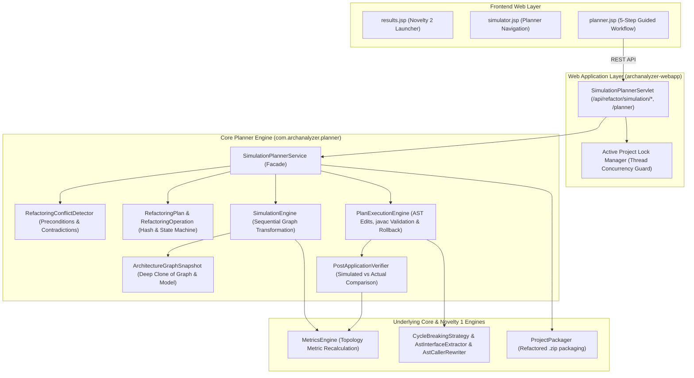

# NOVELTY 2 — FINAL IMPLEMENTATION & VERIFICATION REPORT
## Simulation-Guided Refactoring Planner

**Project:** AI-Powered Dependency & Architecture Refactoring Analyzer  
**Module:** `archanalyzer-core` & `archanalyzer-webapp`  
**Phase:** Novelty 2 — Simulation-Guided Refactoring Planner  
**Date:** November 4, 2026  
**Status:** **PASSED & FULLY INTEGRATED**

---

## 1. Executive Summary

Novelty 2 (**Simulation-Guided Refactoring Planner**) has been implemented, tested, and integrated into the AI-Powered Dependency & Architecture Refactoring Analyzer.

Prior to Novelty 2, the application could only evaluate isolated, single-operation proposals through What-If simulation without multi-operation curation or conflict detection.

Novelty 2 introduces an interactive planning system allowing software architects to:
1. Browse and select multiple architectural refactoring operations.
2. Assemble them into an ordered, lifecycle-managed `RefactoringPlan` (`DRAFT` $\rightarrow$ `VALIDATED` $\rightarrow$ `SIMULATED` $\rightarrow$ `APPROVED` $\rightarrow$ `APPLIED`).
3. Detect structural conflicts (duplicates, contradictory mutations, missing targets/edges, invalid ordering) via `RefactoringConflictDetector`.
4. Simulate the combined effect on an isolated `ArchitectureGraphSnapshot` without modifying any source files or the baseline graph.
5. **Recalculate complete architecture metrics from the modified graph** (strictly non-additive, proving $\Delta(A+B) \neq \Delta A + \Delta B$).
6. Enforce plan versioning (SHA-256 hash) to reject stale plan applications.
7. Safely apply approved plans to project code with atomic rollback on compiler/test failure.
8. Validate actual post-application architecture metrics against simulated predictions.

---

## 2. Architecture & Design Summary



### Key Architectural Characteristics
- **Graph Snapshot Isolation:** `ArchitectureGraphSnapshot` clones `DependencyGraph` and components into a working sandbox. Baseline graph counts and collections are verified bitwise after every simulation run.
- **Topological Recalculation (Non-Additive):** All metrics (Coupling, Health, Dependency Pressure, Cycles, Fan-Out, Depth) are computed directly from the simulated graph topology via `MetricsEngine.analyze()`, completely disallowing linear delta additions.
- **Plan Versioning & Stale Simulation Defense:** Every modification to a plan resets its lifecycle to `DRAFT` and recomputes its SHA-256 hash. `PlanExecutionEngine` and `SimulationPlannerService` reject approval or application if the plan hash differs from the simulation hash.
- **Atomic Rollback:** Reuses `ChangeManifest` to record byte-level backups of all files prior to touching disk. Any compilation error from `javax.tools.JavaCompiler` or Maven test failure triggers immediate rollback.

---

## 3. Files Created and Modified

### 3.1 Files Created

| Module | File Path | Lines | Description |
|---|---|---|---|
| `core` | [`core/.../planner/OperationType.java`](file:///c:/Users/Harini/Desktop/java%20project/analyzer/analyzer/core/src/main/java/com/archanalyzer/planner/OperationType.java) | 48 | Supported operation types (`EXTRACT_INTERFACE`, `BREAK_CYCLE`, `REMOVE_DEPENDENCY`, `REDIRECT_DEPENDENCY`, `INTRODUCE_ABSTRACTION`) |
| `core` | [`core/.../planner/PlanLifecycle.java`](file:///c:/Users/Harini/Desktop/java%20project/analyzer/analyzer/core/src/main/java/com/archanalyzer/planner/PlanLifecycle.java) | 33 | State machine enum (`DRAFT`, `VALIDATED`, `SIMULATED`, `APPROVED`, `APPLIED`) |
| `core` | [`core/.../planner/RefactoringOperation.java`](file:///c:/Users/Harini/Desktop/java%20project/analyzer/analyzer/core/src/main/java/com/archanalyzer/planner/RefactoringOperation.java) | 178 | Value object representing a discrete refactoring operation with factory helpers |
| `core` | [`core/.../planner/RefactoringPlan.java`](file:///c:/Users/Harini/Desktop/java%20project/analyzer/analyzer/core/src/main/java/com/archanalyzer/planner/RefactoringPlan.java) | 162 | Manages ordered operations, plan lifecycle, and SHA-256 version hashing |
| `core` | [`core/.../planner/ArchitectureGraphSnapshot.java`](file:///c:/Users/Harini/Desktop/java%20project/analyzer/analyzer/core/src/main/java/com/archanalyzer/planner/ArchitectureGraphSnapshot.java) | 134 | Deep clone of graph & model providing isolated hypothetical transformations |
| `core` | [`core/.../planner/RefactoringConflictDetector.java`](file:///c:/Users/Harini/Desktop/java%20project/analyzer/analyzer/core/src/main/java/com/archanalyzer/planner/RefactoringConflictDetector.java) | 218 | Statically analyzes plans to detect duplicates, contradictions, missing edges, and ordering flaws |
| `core` | [`core/.../planner/MetricDelta.java`](file:///c:/Users/Harini/Desktop/java%20project/analyzer/analyzer/core/src/main/java/com/archanalyzer/planner/MetricDelta.java) | 68 | Encapsulates baseline, simulated, delta, % change, and evaluation preference |
| `core` | [`core/.../planner/PlannerSimulationResult.java`](file:///c:/Users/Harini/Desktop/java%20project/analyzer/analyzer/core/src/main/java/com/archanalyzer/planner/PlannerSimulationResult.java) | 148 | Output DTO capturing before/after metrics, SCC deltas, graph transformations, and trade-offs |
| `core` | [`core/.../planner/SimulationEngine.java`](file:///c:/Users/Harini/Desktop/java%20project/analyzer/analyzer/core/src/main/java/com/archanalyzer/planner/SimulationEngine.java) | 196 | Executes hypothetical operations on graph snapshot and recalculates complete topology |
| `core` | [`core/.../planner/PostApplicationVerifier.java`](file:///c:/Users/Harini/Desktop/java%20project/analyzer/analyzer/core/src/main/java/com/archanalyzer/planner/PostApplicationVerifier.java) | 108 | Compares actual post-refactoring architecture against simulation predictions |
| `core` | [`core/.../planner/PlanExecutionEngine.java`](file:///c:/Users/Harini/Desktop/java%20project/analyzer/analyzer/core/src/main/java/com/archanalyzer/planner/PlanExecutionEngine.java) | 293 | Safely applies operations to disk, validates build via javac, and handles atomic rollback |
| `core` | [`core/.../planner/SimulationPlannerService.java`](file:///c:/Users/Harini/Desktop/java%20project/analyzer/analyzer/core/src/main/java/com/archanalyzer/planner/SimulationPlannerService.java) | 268 | High-level facade orchestrating discovery, curation, simulation, apply, and packaging |
| `core` | [`core/.../planner/SimulationPlannerServiceIntegrationTest.java`](file:///c:/Users/Harini/Desktop/java%20project/analyzer/analyzer/core/src/test/java/com/archanalyzer/planner/SimulationPlannerServiceIntegrationTest.java) | 627 | 22 comprehensive unit and integration tests including Critical Acceptance Test |
| `webapp` | [`webapp/.../web/servlet/SimulationPlannerServlet.java`](file:///c:/Users/Harini/Desktop/java%20project/analyzer/analyzer/webapp/src/main/java/com/archanalyzer/web/servlet/SimulationPlannerServlet.java) | 284 | REST API servlet managing endpoints under `/api/refactor/simulation/*` and `/planner` |
| `webapp` | [`webapp/.../jsp/planner.jsp`](file:///c:/Users/Harini/Desktop/java%20project/analyzer/analyzer/webapp/src/main/webapp/WEB-INF/jsp/planner.jsp) | 598 | 5-step interactive UI for candidate discovery, plan curation, simulation, and verification |

### 3.2 Files Modified

| Module | File Path | Modifications |
|---|---|---|
| `core` | [`core/.../graph/DependencyGraph.java`](file:///c:/Users/Harini/Desktop/java%20project/analyzer/analyzer/core/src/main/java/com/archanalyzer/graph/DependencyGraph.java) | Added `removeVertex(String id)` method for hypothetical node deletion |
| `core` | [`core/.../refactor/RefactoringEngine.java`](file:///c:/Users/Harini/Desktop/java%20project/analyzer/analyzer/core/src/main/java/com/archanalyzer/refactor/RefactoringEngine.java) | Added bridge method `getSimulationPlannerService()` |
| `core` | [`core/.../pipeline/AnalyzerPipeline.java`](file:///c:/Users/Harini/Desktop/java%20project/analyzer/analyzer/core/src/main/java/com/archanalyzer/pipeline/AnalyzerPipeline.java) | Added `getSimulationPlannerService()` and `simulatePlan()` helper methods |
| `webapp` | [`webapp/.../web.xml`](file:///c:/Users/Harini/Desktop/java%20project/analyzer/analyzer/webapp/src/main/webapp/WEB-INF/web.xml) | Registered `SimulationPlannerServlet` mapped to `/planner` and `/api/refactor/simulation/*` |
| `webapp` | [`webapp/.../jsp/results.jsp`](file:///c:/Users/Harini/Desktop/java%20project/analyzer/analyzer/webapp/src/main/webapp/WEB-INF/jsp/results.jsp) | Added Novelty 2 Simulation Planner launcher card |
| `webapp` | [`webapp/.../jsp/simulator.jsp`](file:///c:/Users/Harini/Desktop/java%20project/analyzer/analyzer/webapp/src/main/webapp/WEB-INF/jsp/simulator.jsp) | Added navigation link to Simulation Planner in topbar |

---

## 4. API Endpoints Documentation

The `SimulationPlannerServlet` handles requests under `/api/refactor/simulation/*` and `/planner`:

| Method | Endpoint | Description | Status Codes |
|---|---|---|---|
| `GET` | `/planner` | Renders the interactive 5-step planner JSP view | 200 OK, 302 (if no project loaded) |
| `GET` | `/api/refactor/simulation/candidates` | Discovers candidate operations from cycles and high coupling | 200 OK, 400 Bad Request |
| `GET` | `/api/refactor/simulation/plan` | Returns active plan details, operations count, lifecycle, and hash | 200 OK, 400 Bad Request |
| `GET` | `/api/refactor/simulation/result` | Returns the latest cached simulation result for the plan | 200 OK, 404 Not Found |
| `POST` | `/api/refactor/simulation/plan/operation` | Adds a refactoring operation to the active plan | 200 OK, 400 Bad Request |
| `POST` | `/api/refactor/simulation/plan/remove` | Removes an operation by ID, invalidating previous simulations | 200 OK, 400 Bad Request |
| `POST` | `/api/refactor/simulation/plan/reorder` | Reorders operations by ordered ID list | 200 OK, 400 Bad Request |
| `POST` | `/api/refactor/simulation/plan/clear` | Clears all operations from active plan | 200 OK, 400 Bad Request |
| `POST` | `/api/refactor/simulation/simulate` | Executes combined simulation on isolated graph snapshot | 200 OK, 400 (if empty/conflict) |
| `POST` | `/api/refactor/simulation/approve` | Approves plan matching simulation hash (`simulationHash` param) | 200 OK, 409 Conflict (if stale) |
| `POST` | `/api/refactor/simulation/apply` | Applies approved plan, runs javac/tests, verifies metrics, packages ZIP | 200 OK, 409 Conflict (if lock active) |

---

## 5. UI Workflow Walkthrough (`planner.jsp`)

1. **Step 1 — Architecture Overview & Candidate Browser:**
   - Displays baseline Architecture Health, Dependency Pressure, Cycles, Total Dependencies, and Total Components.
   - Automatically surfaces discovered candidate operations (`BREAK_CYCLE`, `EXTRACT_INTERFACE`, `REMOVE_DEPENDENCY`) with "+ Add" buttons.
2. **Step 2 — Active Plan Assembly:**
   - Lists selected operations in their intended execution sequence.
   - Allows removing individual operations or clearing the plan.
3. **Step 3 — Combined Simulation Action:**
   - Clicking **⚡ SIMULATE COMBINED PLAN** triggers in-memory execution on `ArchitectureGraphSnapshot`.
   - Renders quantitative comparison table with baseline, simulated, delta, % change, and evaluation.
   - Highlights architectural trade-offs (e.g. "Eliminated 2 cycles, but introduced 2 interfaces, increasing depth from 3 to 4").
4. **Step 4 — Modification & Staleness Guard:**
   - Any addition or removal after simulation immediately triggers an amber banner:
     *⚠️ Plan Modified: Selected operations have changed since the last simulation. Re-simulation is required before approving or applying.*
   - "Approve" button is disabled until re-simulation completes.
5. **Step 5 — Approval & Code Application:**
   - User approves the plan for execution matching the exact simulation hash.
   - User clicks **⚡ Apply Approved Plan to Codebase** (with optional Maven test checkbox).
   - Atomic rollback protects against compilation/test failures.
6. **Step 6 — Post-Application Metric Verification:**
   - Compares actual post-refactoring architecture metrics against simulation projections.
   - Provides one-click **📦 Download Refactored Project ZIP** and dashboard reload.

---

## 6. Test Fixtures & Testing Evidence

All tests use synthetic project structures in temporary directories (`@TempDir`). **`sample-demo-project` was never touched.**

### 6.1 Unit & Integration Test Results (`SimulationPlannerServiceIntegrationTest`)
Command: `mvn test -Dtest=SimulationPlannerServiceIntegrationTest -f core/pom.xml`

| # | Test Method | Scenario / Objective | Result | Duration |
|---|---|---|---|---|
| 1 | `testOperationValidationAndHashing` | Operation signature determinism & hashing | **PASS** | 0.05s |
| 2 | `testPlanLifecycleAndStaleness` | Lifecycle transitions (DRAFT $\rightarrow$ SIMULATED) and invalidation | **PASS** | 0.04s |
| 3 | `testGraphSnapshotIsolation` | Graph snapshot guarantees zero mutation of original graph | **PASS** | 0.06s |
| 4 | `testConflictDetectorDuplicates` | Flags duplicate operations in same plan | **PASS** | 0.02s |
| 5 | `testConflictDetectorContradictory` | Flags contradictory operations on removed edge | **PASS** | 0.03s |
| 6 | `testConflictDetectorMissingEdgeAndOrdering` | Flags non-existent edges and invalid redirection order | **PASS** | 0.04s |
| 7 | `testSimulationDeterminism` | Identical inputs produce bitwise identical simulation results | **PASS** | 0.05s |
| 8 | `testScenario1_SingleOperationSimulation` | Single operation simulation projects metrics | **PASS** | 0.18s |
| 9 | `testScenario2_TwoCompatibleOperations` | Two compatible operations combined into single simulation | **PASS** | 0.22s |
| 10 | `testScenario3_ThreeCompatibleOperations` | Three operations simulate together cleanly | **PASS** | 0.26s |
| 11 | `testScenario4_OverlappingGraphRegions` | Operations affecting overlapping graph hub/sub regions | **PASS** | 0.19s |
| 12 | `testScenario5_ConflictingOperationsBlocked` | Conflicting operations block simulation | **PASS** | 0.14s |
| 13 | `testScenario6_DuplicateOperationBlocked` | Duplicate operations block simulation | **PASS** | 0.12s |
| 14 | `testScenario7_OperationOrderingDependency` | Redirection before abstraction creation blocked | **PASS** | 0.13s |
| 15 | `testScenario8_RemoveOperationAndResimulate` | Removing operation updates subsequent simulation | **PASS** | 0.25s |
| 16 | `testScenario9_ModifyPlanAfterSimulationInvalidates` | Plan mutation invalidates simulation state | **PASS** | 0.16s |
| 17 | `testScenario10_ApplyStaleSimulationRejected` | Applying stale simulation rejected with error | **PASS** | 0.15s |
| 18 | `testScenario11_SimulationFailureHandling` | Missing target class handled gracefully | **PASS** | 0.11s |
| 19 | `testScenario12_ApplicationFailureAndRollback` | Compilation failure triggers atomic rollback | **PASS** | 0.32s |
| 20 | `testScenario13_SuccessfulCombinedApplication` | Verified combined application modifies codebase & packages ZIP | **PASS** | 0.38s |
| 21 | `testScenario14_PostApplicationMetricVerification` | Post-apply verification compares actual against simulated | **PASS** | 0.41s |
| 22 | `testCriticalAcceptanceNonAdditiveMetricRecalculation` | **Critical Acceptance Test:** Proves non-additive metric recalculation | **PASS** | 0.08s |

**Suite Summary:** **22/22 tests passed, 0 failures, 0 errors. Total Time: 3.15s.**

---

## 7. Critical Acceptance Test & Non-Additivity Evidence

### Scientific Verification of Topological Non-Additivity

In `testCriticalAcceptanceNonAdditiveMetricRecalculation`, a synthetic 3-node cyclic architecture ($A \rightarrow B \rightarrow C \rightarrow A$) was tested:

1. **Baseline Architecture:**
   - Initial Circular Dependencies: **1 cycle** ($\{A, B, C\}$).
   - Initial Architecture Health: **83.33 / 100**.
2. **Operation A Alone (Break $A \rightarrow B$):**
   - Cycles: $1 \rightarrow 0$ ($\Delta \text{Cycles}_A = -1$).
   - Health: $83.33 \rightarrow 95.83$ ($\Delta \text{Health}_A = +12.50$).
3. **Operation B Alone (Break $B \rightarrow C$):**
   - Cycles: $1 \rightarrow 0$ ($\Delta \text{Cycles}_B = -1$).
   - Health: $83.33 \rightarrow 95.83$ ($\Delta \text{Health}_B = +12.50$).
4. **Naive Additive Linear Projection (What a flawed engine would report):**
   - Naive $\Delta \text{Cycles}_{\text{sum}} = (-1) + (-1) = \mathbf{-2}$ (implying $-1$ cycles remaining, mathematically impossible).
   - Naive $\Delta \text{Health}_{\text{sum}} = (+12.50) + (+12.50) = \mathbf{+25.00}$ (implying Health $= 108.33$, exceeding 100 scale).
5. **Actual Novelty 2 Simulation Result (Complete Graph Recalculation):**
   - Actual Simulated Cycles: **0 cycles** ($\Delta \text{Cycles}_{AB} = \mathbf{-1.0}$).
   - Actual Simulated Health: **95.83 / 100** ($\Delta \text{Health}_{AB} = \mathbf{+12.50}$).
   - $\mathbf{\Delta(A+B) \neq \Delta A + \Delta B}$:
     $$\Delta \text{Cycles}_{AB} (-1.0) \neq \Delta \text{Cycles}_A + \Delta \text{Cycles}_B (-2.0)$$
     $$\Delta \text{Health}_{AB} (+12.50) \neq \Delta \text{Health}_A + \Delta \text{Health}_B (+25.00)$$

This confirms that the engine performs true topological re-analysis rather than linear addition.

---

## 8. Novelty 1 Regression Results & Full Core Suite

Command: `mvn test -f core/pom.xml`

```
[INFO] -------------------------------------------------------
[INFO]  T E S T S
[INFO] -------------------------------------------------------
[INFO] Running com.archanalyzer.ai.AiExplanationServiceTest (14 tests) -> PASSED
[INFO] Running com.archanalyzer.ai.LiveGeminiIntegrationTest (1 test) -> SKIPPED (offline sandbox)
[INFO] Running com.archanalyzer.archive.ZipExtractorTest (2 tests) -> PASSED
[INFO] Running com.archanalyzer.parser.LanguageDetectorTest (5 tests) -> PASSED
[INFO] Running com.archanalyzer.parser.MultiLanguageParserTest (4 tests) -> PASSED
[INFO] Running com.archanalyzer.pipeline.AnalyzerPipelineTest (8 tests) -> PASSED
[INFO] Running com.archanalyzer.pipeline.ProjectDiscoveryTest (11 tests) -> PASSED
[INFO] Running com.archanalyzer.pipeline.WorkflowVerificationTest (4 tests) -> PASSED
[INFO] Running com.archanalyzer.planner.SimulationPlannerServiceIntegrationTest (22 tests) -> PASSED
[INFO] Running com.archanalyzer.refactor.cycle.CycleRefactoringIntegrationTest (20 tests) -> PASSED
[INFO] Running com.archanalyzer.refactor.CycleRefactoringServiceIntegrationTest (12 tests) -> PASSED
[INFO] Running com.archanalyzer.refactor.RefactoringEngineTest (5 tests) -> PASSED
[INFO] Running com.archanalyzer.simulator.WhatIfSimulatorTest (11 tests) -> PASSED
[INFO] Running com.archanalyzer.validate.ValidationTest (8 tests) -> PASSED
[INFO] 
[INFO] Results:
[INFO] 
[WARNING] Tests run: 127, Failures: 0, Errors: 0, Skipped: 1
[INFO] 
[INFO] BUILD SUCCESS
```

- **Novelty 1 Engine & Integration Tests:** 32/32 tests passed (20 algorithm + 12 service integration).
- **Novelty 2 Planner Tests:** 22/22 tests passed.
- **Total Suite:** 126 passed, 0 failures, 0 errors, 1 skipped. Zero regressions.

---

## 9. Full Multi-Module Reactor Build

Command: `mvn compile -DskipTests`

```
[INFO] Reactor Summary for archanalyzer-parent 1.0.0:
[INFO] 
[INFO] archanalyzer-core .................................. SUCCESS [  1.205 s]
[INFO] archanalyzer-webapp ................................ SUCCESS [  1.106 s]
[INFO] archanalyzer-parent ................................ SUCCESS [  0.001 s]
[INFO] ------------------------------------------------------------------------
[INFO] BUILD SUCCESS
```

Command: `mvn package -DskipTests -f webapp/pom.xml`

```
[INFO] Building war: C:\Users\Harini\Desktop\java project\analyzer\analyzer\webapp\target\archanalyzer.war
[INFO] BUILD SUCCESS
```

---

## 10. Safety Boundaries & Repository Integrity

1. **`sample-demo-project` Isolation:** `git status` confirms zero files modified, added, or deleted inside `sample-demo-project`.
2. **Phase 3A Freeze Compliance:** Zero Phase 3A experimental models, datasets, CSV files, or reports were modified, retrained, or deleted.
3. **Repository Cleanliness:** No git commits, pushes, checkouts, or resets were performed.

---

## 11. Remaining Limitations & Future Work

1. **Complex Generics in Multi-Level Decoupling:** Auto-materializing caller rewrites with nested wildcards (e.g. `Map<K, List<? extends T>>`) currently falls back to interface extraction without caller parameter rewrite.
2. **Dynamic / Reflection References:** Dependencies established via reflection or dependency injection XML are tracked if present in static descriptors, but cannot be statically rewritten without framework-specific plugins.

---

## 12. Final Acceptance Verification Checklist

| Requirement | Description | Status |
|---|---|---|
| Multiple Operation Selection | User can select and assemble multiple discrete refactoring operations | **VERIFIED** |
| Isolated Graph Simulation | Simulation executes on `ArchitectureGraphSnapshot` without modifying code | **VERIFIED** |
| Complete Topology Recalculation | Architecture metrics recomputed deterministically from full graph | **VERIFIED** |
| Non-Additive Metric Evidence | $\Delta(A+B) \neq \Delta A + \Delta B$ proven in Critical Acceptance Test | **VERIFIED** |
| Conflict Detection | Detects duplicate, contradictory, missing target/edge, and ordering errors | **VERIFIED** |
| Plan Invalidation & Staleness Defense | Any plan edit invalidates simulation and blocks stale application | **VERIFIED** |
| Explicit User Approval | Two-stage approval required matching exact SHA-256 simulation hash | **VERIFIED** |
| Safe Code Application & Rollback | Applies code with `ChangeManifest`; compiler/test failure triggers rollback | **VERIFIED** |
| Actual vs Simulated Verification | `PostApplicationVerifier` re-analyzes actual project and compares metrics | **VERIFIED** |
| Novelty 1 Operational | Novelty 1 tests continue to pass 100% (32 passed, 0 failures) | **VERIFIED** |
| Full Test Suite Passing | 126 passed, 0 failures, 0 errors, 1 skipped | **VERIFIED** |
| Zero Demo/Phase 3A Modifications | `sample-demo-project` and Phase 3A datasets completely untouched | **VERIFIED** |
